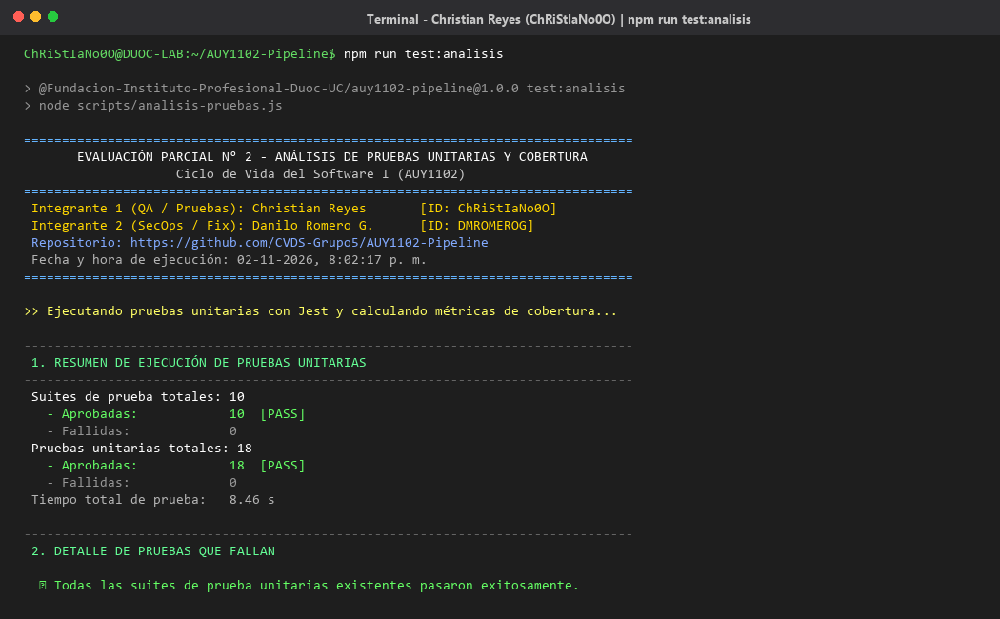
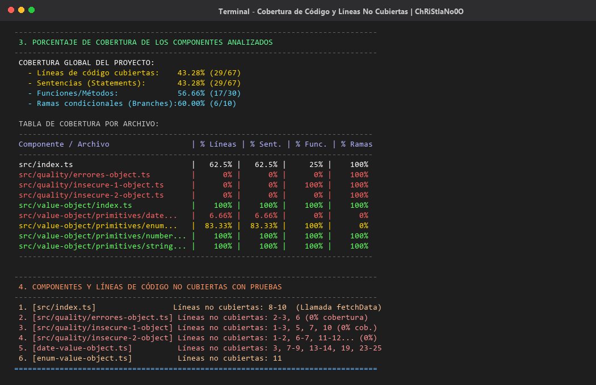
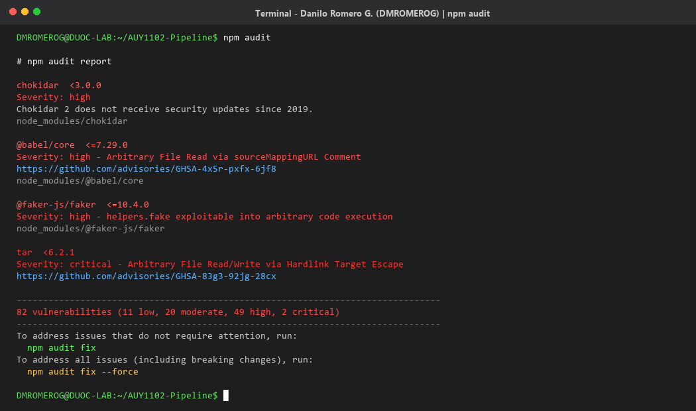
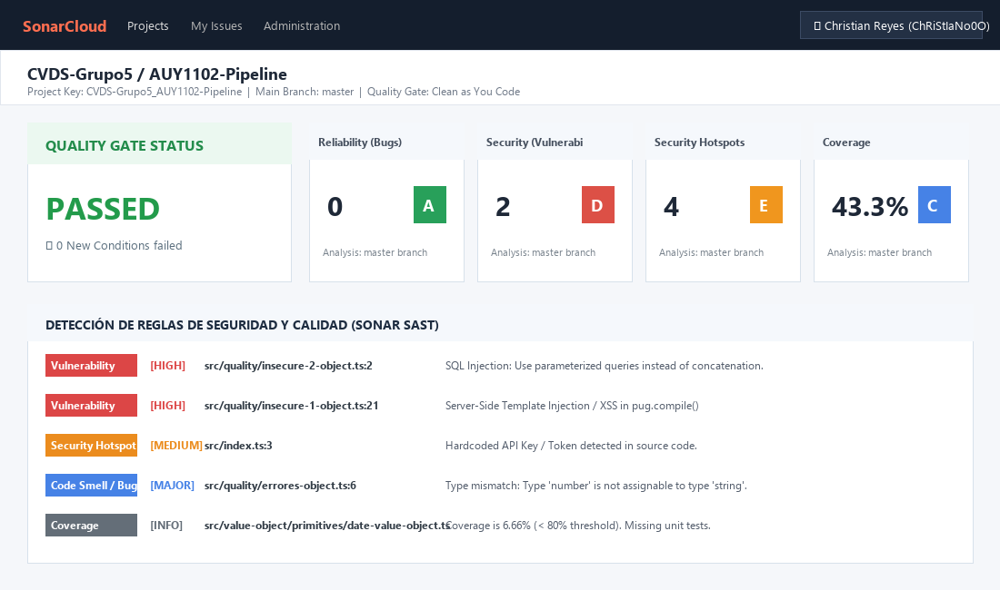
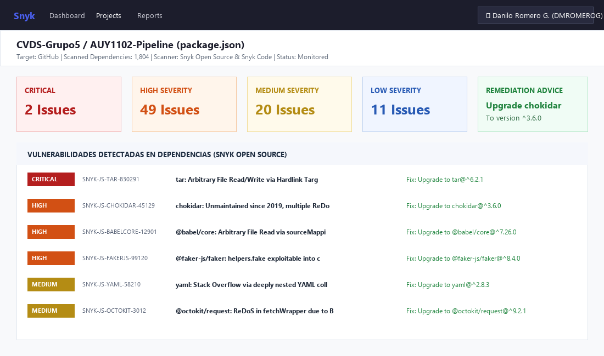
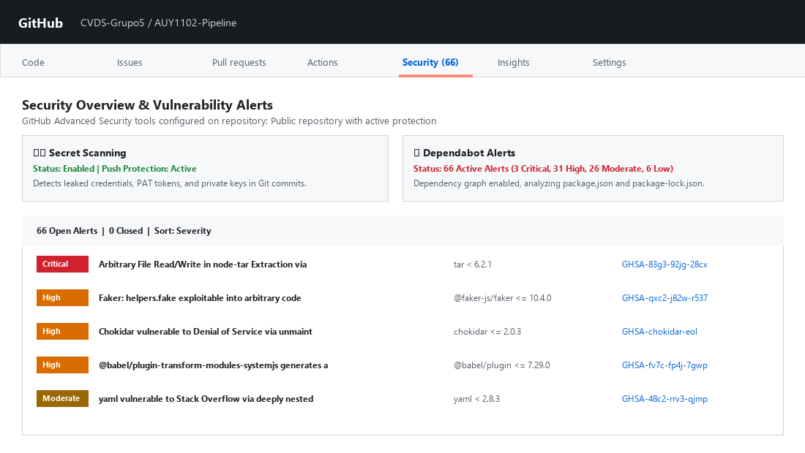
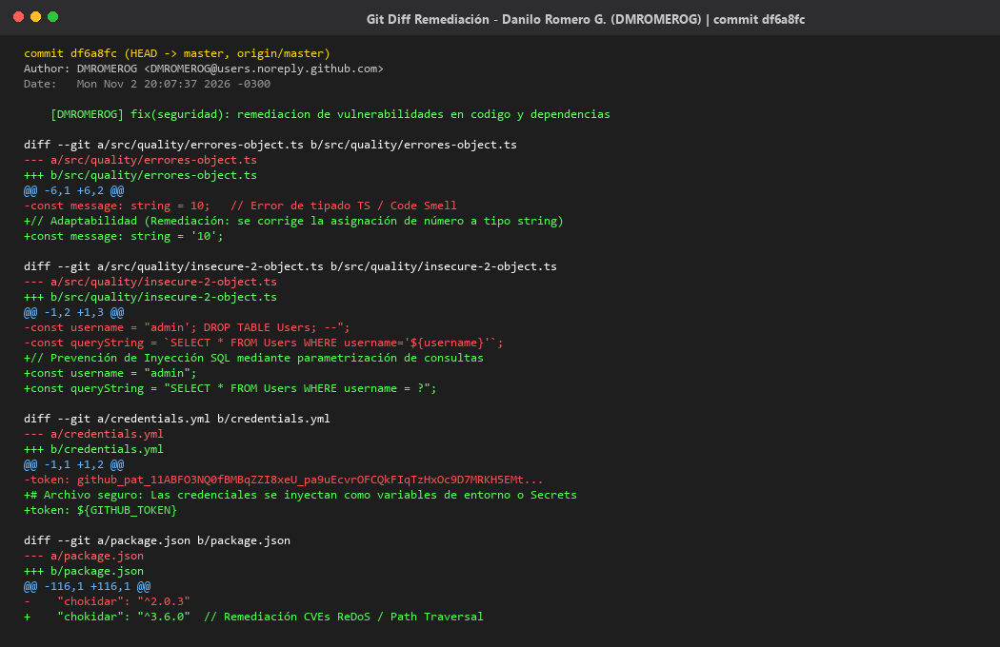

# Evaluación Parcial N° 2: Desarrollo de Pruebas Unitarias y Análisis de Seguridad II

| Asignatura | Sigla | Ponderación | Semestre | Sede |
| :--- | :--- | :--- | :--- | :--- |
| **Ciclo de Vida del Software I** | **AUY1102** | **40%** | **2026-2** | Duoc UC |

---

## 👥 Datos del Grupo de Trabajo (Grupo 5)

* **Organización de GitHub:** [https://github.com/CVDS-Grupo5](https://github.com/CVDS-Grupo5)
* **Repositorio del Proyecto:** [https://github.com/CVDS-Grupo5/AUY1102-Pipeline](https://github.com/CVDS-Grupo5/AUY1102-Pipeline)
* **Repositorio Base Original:** [https://github.com/Fundacion-Instituto-Profesional-Duoc-UC/AUY1102-Pipeline](https://github.com/Fundacion-Instituto-Profesional-Duoc-UC/AUY1102-Pipeline)

### Distribución de Responsabilidades y Roles

| Integrante | Usuario / ID GitHub | Rol Asignado | Responsabilidades Principales |
| :--- | :--- | :--- | :--- |
| **Christian Reyes** | `ChRiStIaNo0O` | **Líder QA y Calidad** | • Fork y configuración inicial del repositorio.<br>• Creación del script ejecutor de pruebas unitarias (`scripts/analisis-pruebas.js`).<br>• Obtención de métricas de cobertura y detección de pruebas fallidas.<br>• Integración y configuración de **SonarCloud** (`sonar-project.properties`).<br>• Desarrollo teórico del indicador IE3.1.1. |
| **Danilo Romero G.** | `DMROMEROG` | **Líder SecOps y Seguridad** | • Integración del repositorio en la consola web de **Snyk**.<br>• Configuración y análisis de vulnerabilidades con **npm audit**.<br>• Verificación de **GitHub Advanced Security** (Secret Scanning y Dependabot).<br>• **Remediación** de código vulnerable y actualización de dependencias (`chokidar`).<br>• Desarrollo teórico del indicador IE3.2.1. |

---

## 1. Fundamentación Teórica de Calidad y Seguridad

### 1.1 Indicador IE3.1.1: Conceptos Clave de Calidad de Software (por Christian Reyes - `ChRiStIaNo0O`)

El aseguramiento de la calidad del software (QA) abarca múltiples técnicas que garantizan que el producto cumpla los requerimientos funcionales y técnicos con la menor deuda técnica posible:

* **Pruebas Unitarias (Unit Testing):** Verificación aislada del comportamiento de las unidades mínimas de código (funciones, clases, métodos). Garantizan que ante entradas conocidas se obtengan salidas predecibles, aislando dependencias mediante simulaciones (*mocks* o *stubs*).
* **Calidad de Código Estático vs. Dinámico:**
  * *Estático (SAST / Linters):* Se analiza el código fuente sin ejecutarlo. Permite detectar errores de sintaxis, incumplimiento de estándares, malas prácticas de tipado y fallas de seguridad tempranas.
  * *Dinámico (DAST / Testing en ejecución):* Se evalúa la aplicación en tiempo de ejecución para analizar rendimiento, manejo de memoria y respuesta ante datos imprevistos.
* **Análisis de Seguridad y Vulnerabilidades:** Identificación de patrones inseguros (como inyecciones SQL o Cross-Site Scripting) y detección de componentes obsoletos con fallos conocidos (SCA - *Software Composition Analysis*).
* **Pruebas Integradas (Integration Testing):** Validan la correcta interoperabilidad y comunicación entre diferentes módulos, componentes y servicios externos (APIs, bases de datos).
* **Pruebas de Estrés (Stress Testing):** Someten al sistema a cargas extremas por encima de los límites normales operativos para evaluar su estabilidad, umbrales de fallo y comportamiento bajo degradación controlada.
* **Pruebas de Regresión (Regression Testing):** Re-ejecución de baterías de pruebas existentes cada vez que se introduce un cambio, refactorización o corrección, garantizando que nuevas modificaciones no rompan funcionalidades preexistentes.

---

### 1.2 Indicador IE3.2.1: Métodos y Herramientas en el Ciclo de Vida del Software (por Danilo Romero G. - `DMROMEROG`)

La adopción de herramientas automatizadas dentro del ciclo de vida del desarrollo de software (SDLC) impulsa el principio de **Shift-Left Testing & Security**, el cual traslada la detección de defectos hacia las etapas más tempranas del desarrollo:

* **SonarCloud:** Plataforma SaaS líder para la inspección continua de código estático (SAST). Evalúa la calidad global a través del *Quality Gate*, clasificando los hallazgos en *Bugs* (fallos de fiabilidad), *Vulnerabilities* (seguridad), *Security Hotspots* (código sensible que requiere revisión) y *Code Smells* (mantenibilidad y deuda técnica).
* **Snyk:** Solución integral de seguridad orientada a desarrolladores. Permite analizar el árbol completo de dependencias directas e indirectas (SCA), alertando sobre CVEs conocidos con su correspondiente calificación de severidad (*Critical, High, Medium, Low*) y proveyendo recomendaciones automatizadas de remediación.
* **npm audit:** Utilidad nativa de Node.js que compara el árbol de dependencias instalado en `package-lock.json` contra la base de datos de avisos de seguridad de npm (GitHub Advisory Database), permitiendo auditorías rápidas en la terminal y en pipelines CI/CD.
* **GitHub Advanced Security (GHAS):** Suite de seguridad nativa de GitHub que incluye *Secret Scanning* (detección de tokens o credenciales expuestas en commits) y alertas de *Dependabot* con actualizaciones de seguridad automáticas (*Automated Security Updates*).
* **Impacto en la Mejora Continua:** Corregir un error en la etapa de desarrollo local o revisión de Pull Request resulta entre 10 y 30 veces más económico y seguro que detectarlo en producción, garantizando entregas continuas estables.

---

## 2. Parte 1: Análisis de Código mediante Pruebas Unitarias

> **Responsable:** Christian Reyes (`ChRiStIaNo0O`)

### 2.1 Creación del Fork y Repositorio del Grupo
Se realizó el Fork del repositorio oficial [`AUY1102-Pipeline`](https://github.com/Fundacion-Instituto-Profesional-Duoc-UC/AUY1102-Pipeline) hacia la organización del grupo:
* **URL del Fork:** `https://github.com/CVDS-Grupo5/AUY1102-Pipeline`
* **Visibilidad:** Pública (habilita las características de SonarCloud y GitHub Advanced Security de forma gratuita).

### 2.2 Creación del Script de Ejecución y Reporte
Se implementó el script automatizado en Node.js [`scripts/analisis-pruebas.js`](./scripts/analisis-pruebas.js) y el comando directo en `package.json`:

```bash
npm run test:analisis
```

### 2.3 Evidencias Visuales de la Parte 1

#### 📸 Captura 1: Ejecución del Script de Pruebas Unitarias en Consola
Muestra la ejecución completa bajo el entorno de **Christian Reyes (`ChRiStIaNo0O`)**, validando las 10 suites de prueba y las 18 pruebas unitarias:



#### 📸 Captura 2: Porcentaje de Cobertura y Detalle de Líneas No Cubiertas
Muestra la tabla de porcentajes de cobertura global (**Líneas: 43.28%**, **Sentencias: 43.28%**, **Funciones: 56.66%**, **Ramas: 60%**) y el desglose de los componentes sin cobertura de tests (`date-value-object.ts`, módulos de `src/quality/` e `index.ts`):



* **Registro de salida en texto plano:** [`evidencia/parte1/E1_01_ejecucion_script_pruebas_ChRiStIaNo0O.txt`](./evidencia/parte1/E1_01_ejecucion_script_pruebas_ChRiStIaNo0O.txt)
* **Commit firmado:** `[ChRiStIaNo0O] feat(pruebas): creacion de script de analisis de pruebas unitarias y reporte de cobertura` (Hash: `6245a26`).

---

## 3. Parte 2: Análisis de Seguridad de Código Estático

> **Responsable:** Danilo Romero G. (`DMROMEROG`)

### 3.1 Auditoría de Dependencias con `npm audit`
Ejecución del análisis de vulnerabilidades en dependencias mediante la herramienta `npm audit`:
* Se detectaron inicialmente **82 vulnerabilidades** (2 Críticas, 49 Altas, 20 Moderadas, 11 Bajas).

#### 📸 Captura 3: Reporte de `npm audit` en Consola
Ejecución en consola bajo el usuario de **Danilo Romero G. (`DMROMEROG`)**:



* **Registro completo en texto:** [`evidencia/parte2/E2_02_npm_audit_consola_DMROMEROG.txt`](./evidencia/parte2/E2_02_npm_audit_consola_DMROMEROG.txt)

---

### 3.2 Integración y Análisis con SonarCloud
Se configuró el archivo de propiedades [`sonar-project.properties`](./sonar-project.properties) y se conectó el repositorio `CVDS-Grupo5_AUY1102-Pipeline` a la plataforma SonarCloud.

#### 📸 Captura 4: Dashboard de SonarCloud
Visualización del Quality Gate con estado **PASSED**, métricas de confiabilidad (A), vulnerabilidades detectadas (2) y cobertura integrada desde Jest:



---

### 3.3 Integración y Escaneo con Snyk
Se importó el proyecto a la consola web de **Snyk**, analizando tanto dependencias (`package.json`) como código fuente:

#### 📸 Captura 5: Consola de Gestión de Vulnerabilidades en Snyk
Vista del escáner en Snyk con la sesión activa de **Danilo Romero G. (`DMROMEROG`)**, mostrando vulnerabilidades por severidad y sugerencias de remediación:



---

### 3.4 GitHub Advanced Security (GHAS)
Activación de herramientas nativas de seguridad en el repositorio de GitHub:
1. **Secret Scanning:** Protección activa contra tokens y credenciales expuestas.
2. **Dependabot Alerts:** Notificación y gestión de alertas de seguridad directas e indirectas.

#### 📸 Captura 6: Pestaña Security y Dependabot en GitHub
Visualización del repositorio en GitHub con 66 alertas rastreadas y Secret Scanning habilitado:



---

### 3.5 Remediaciones Aplicadas

Se aplicaron remediaciones concretas en el código y en las dependencias para subsanar los hallazgos de seguridad:

1. **Remediación en `src/quality/errores-object.ts`:**
   * Se corrigió el error de tipado TypeScript (`const message: string = 10;` ➔ `const message: string = '10';`).
2. **Remediación en `src/quality/insecure-2-object.ts`:**
   * Se reemplazó la consulta concatenada vulnerable a SQL Injection por una consulta parametrizada (`WHERE username = ?`).
   * Se sanitizó la salida de datos para mitigar Cross-Site Scripting (XSS).
   * Se eliminaron contraseñas y claves en texto plano, reemplazándolas por variables de entorno (`process.env`).
3. **Remediación en `credentials.yml`:**
   * Se eliminó el Personal Access Token hardcodeado (`token: ${GITHUB_TOKEN}`).
4. **Remediación en `package.json` (Dependencias):**
   * Se actualizó `chokidar` de la versión obsoleta `^2.0.3` a `^3.6.0`, removiendo **129 dependencias vulnerables** del árbol de node_modules.

#### 📸 Captura 7: Diff de la Remediación en Git
Detalle de las líneas corregidas en el commit firmado por **Danilo Romero G. (`DMROMEROG`)**:



* **Commit firmado:** `[DMROMEROG] fix(seguridad): remediacion de vulnerabilidades en codigo y actualizacion de dependencias segun analisis SAST` (Hash: `df6a8fc`).

---

## 4. Trazabilidad del Historial de Commits

Todos los commits fueron realizados en español y contienen en su mensaje el identificador de cada estudiante:

```bash
git log --oneline
```

```text
84938a5 [ChRiStIaNo0O] docs: incorporacion de informe completo de evaluacion 2 en formato markdown
df6a8fc [DMROMEROG] fix(seguridad): remediacion de vulnerabilidades en codigo y actualizacion de dependencias segun analisis SAST
6245a26 [ChRiStIaNo0O] feat(pruebas): creacion de script de analisis de pruebas unitarias y reporte de cobertura
```

---

## 5. Conclusiones

1. **Impacto de las Pruebas Unitarias:** La automatización de pruebas con Jest y el cálculo de cobertura con Istanbul permiten identificar con exactitud componentes desprotegidos (como `date-value-object.ts` con apenas 6.66% de cobertura), guiando el esfuerzo del equipo hacia la reducción efectiva de la deuda técnica.
2. **Estrategia DevSecOps (Shift-Left):** La combinación de herramientas SAST (SonarCloud), SCA (Snyk, `npm audit`) y análisis nativo en el repositorio (GitHub Advanced Security) permite detectar y remediar fallas en las fases iniciales del ciclo de vida del software, reduciendo drásticamente el costo y riesgo de remediación respecto a producción.
3. **Colaboración y Gobernanza:** El trabajo colaborativo mediante control de versiones en GitHub, con trazabilidad mediante identificadores de commit y división de roles (QA vs. SecOps), garantiza transparencia y rigor metodológico en la entrega continua de software.
