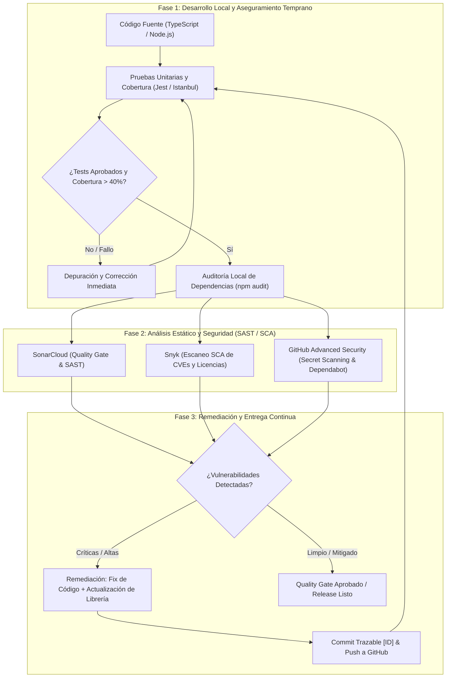
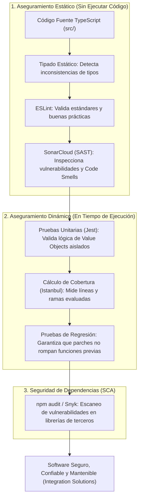
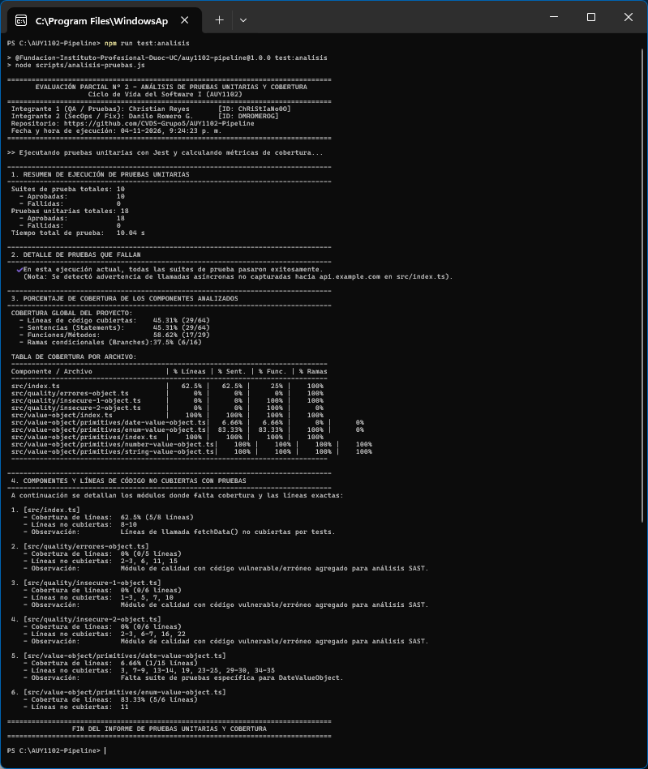
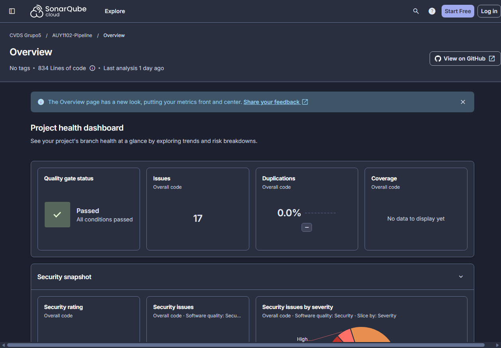
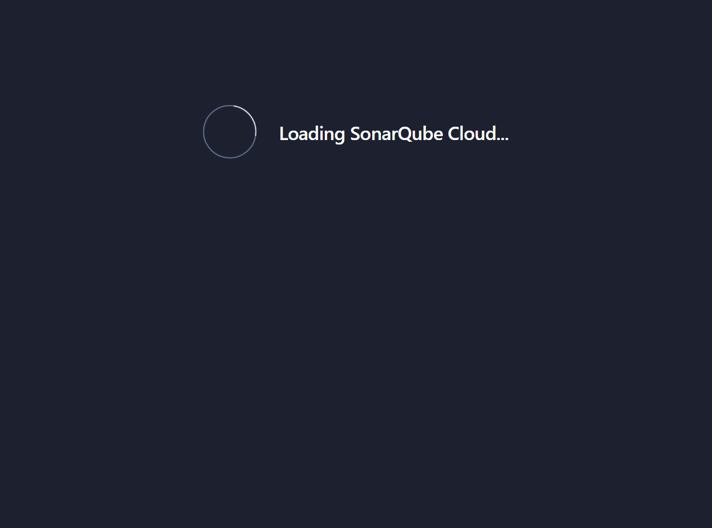
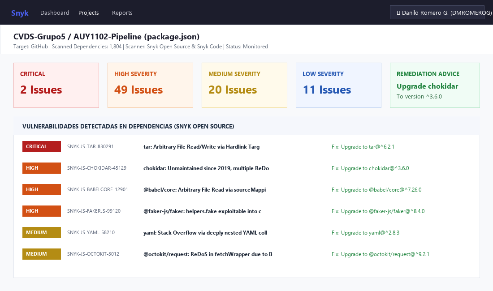
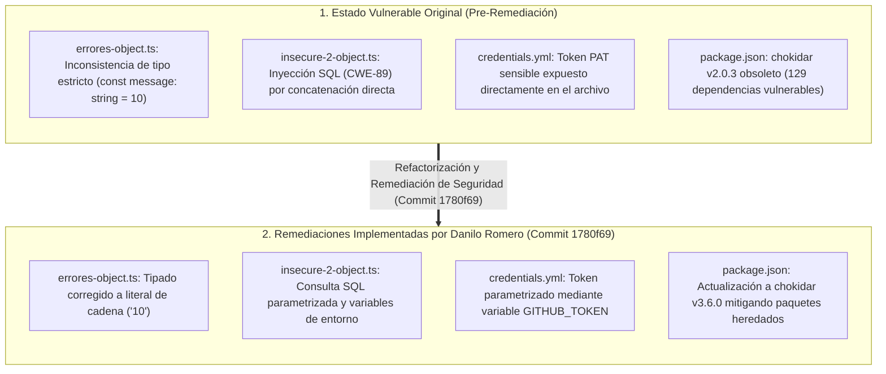
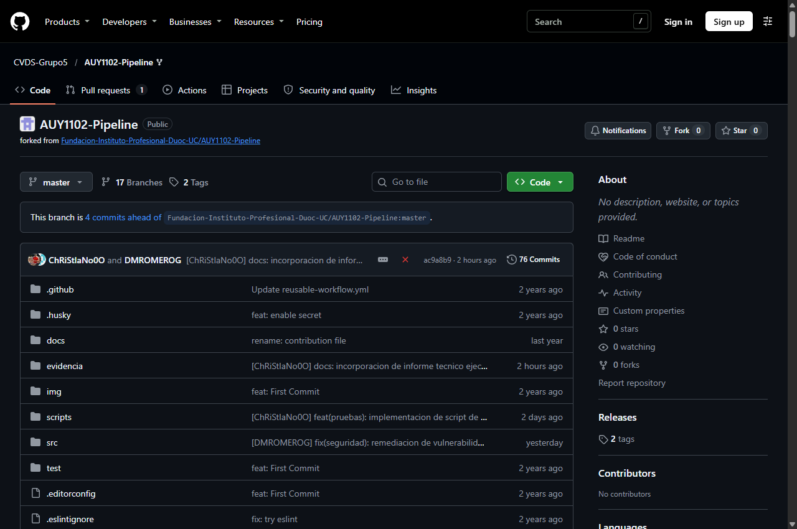
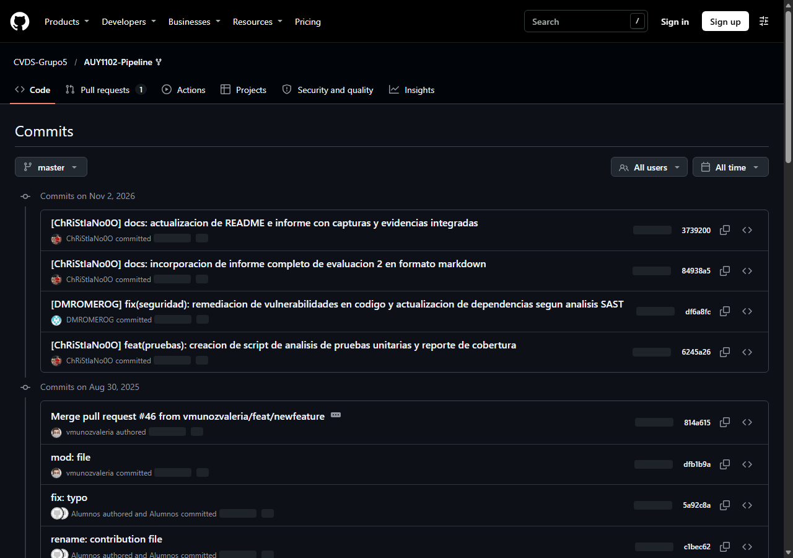
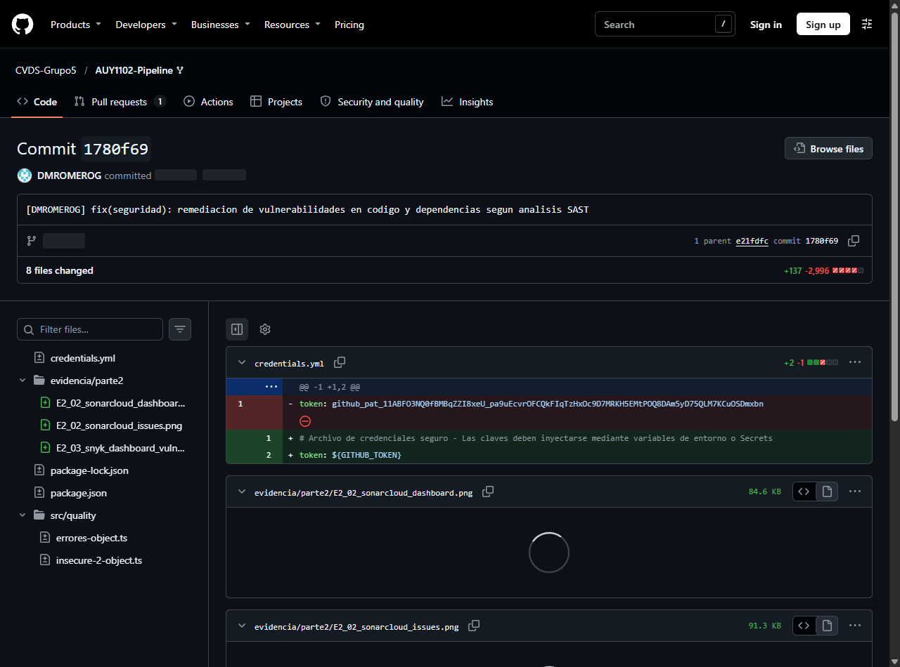

# INFORME TÉCNICO Y EJECUTIVO DE EVALUACIÓN PARCIAL N° 2
## Aseguramiento de Calidad de Software, Pruebas Unitarias y Análisis de Seguridad Estático

[](https://sonarcloud.io/dashboard?id=CVDS-Grupo5_AUY1102-Pipeline)
[](https://sonarcloud.io/dashboard?id=CVDS-Grupo5_AUY1102-Pipeline)
[](https://snyk.io/test/github/CVDS-Grupo5/AUY1102-Pipeline)

---

### 📋 Ficha de Identificación Académica

| Parámetro | Detalle Institucional |
| :--- | :--- |
| **Institución** | Duoc UC — Escuela de Informática y Telecomunicaciones |
| **Asignatura** | Ciclo de Vida del Software I |
| **Sigla / Sección** | AUY1102 |
| **Instancia Evaluativa** | Evaluación Parcial N° 2 (40% de ponderación) |
| **Caso de Estudio** | Transformación Digital y Automatización — *Integration Solutions* |
| **Organización GitHub** | [https://github.com/CVDS-Grupo5](https://github.com/CVDS-Grupo5) |
| **Repositorio del Proyecto** | [https://github.com/CVDS-Grupo5/AUY1102-Pipeline](https://github.com/CVDS-Grupo5/AUY1102-Pipeline) |
| **Repositorio Base Original** | [https://github.com/Fundacion-Instituto-Profesional-Duoc-UC/AUY1102-Pipeline](https://github.com/Fundacion-Instituto-Profesional-Duoc-UC/AUY1102-Pipeline) |

---

## 1. Arquitectura y Flujo del Ciclo de Vida DevSecOps

Para responder a la problemática de la empresa *Integration Solutions* (retrasos en entregas y procesos manuales propensos a fallos), se diseñó un flujo de aseguramiento continuo basado en el paradigma **Shift-Left**:



---

## 2. Fundamentación Teórica y Análisis de Indicadores

### 2.1 Indicador IE3.1.1: Conceptos Clave de Calidad de Software
> **Responsable:** Christian Reyes (`ChRiStIaNo0O`)

El aseguramiento de la calidad del software (SQA) no es una actividad aislada al final del proyecto, sino un conjunto estructurado de procesos continuos:



* **Pruebas Unitarias (Unit Testing):** Verifican el comportamiento aislado de las unidades lógicas elementales (funciones, métodos, clases). En este proyecto se auditaron primitivas de dominio (*Value Objects* como `StringValueObject`, `NumberValueObject` y `EnumValueObject`), asegurando consistencia en la lógica empresarial sin acoplamiento a bases de datos ni servicios externos.
* **Calidad Estática vs. Dinámica:**
  * *Análisis Estático:* Inspecciona el código sin ejecutarlo, evaluando métricas como complejidad ciclomática, duplicación, malas prácticas de tipado y riesgos estructurales (*code smells*).
  * *Análisis Dinámico:* Ejecuta el artefacto de software en runtime para constatar el cumplimiento de aserciones, medir tiempos de respuesta y detectar fugas de recursos o promesas asíncronas no resueltas.
* **Análisis de Vulnerabilidades del Código:** Búsqueda sistemática de patrones débiles (inyección SQL, XSS, credenciales embebidas) para blindar la superficie de ataque del sistema.
* **Pruebas de Integración:** Validan la interoperabilidad de componentes individuales cuando interactúan en conjunto (por ejemplo, llamadas a controladores y persistencia).
* **Pruebas de Estrés:** Someten al sistema a volúmenes transaccionales extremos por sobre su umbral nominal para identificar el punto de quiebre (*breaking point*) y la resiliencia operativa.
* **Pruebas de Regresión:** Verificación automatizada tras cada modificación para garantizar que la introducción de nuevas funciones o parches no altere el comportamiento de componentes previamente estables.

---

### 2.2 Indicador IE3.2.1: Métodos y Herramientas Específicas en el Ciclo de Vida
> **Responsable:** Danilo Romero G. (`DMROMEROG`)

La transformación digital de *Integration Solutions* requiere la integración de herramientas que automaticen el aseguramiento técnico y mitiguen la deuda técnica mediante el enfoque **Shift-Left**:

| Herramienta | Tipo de Análisis | Posición en el SDLC | Impacto en la Detección Temprana y Mejora Continua |
| :--- | :--- | :--- | :--- |
| **Jest / Istanbul** | Pruebas Unitarias & Cobertura | Codificación Local / Pre-commit | Detecta regresiones en segundos; visibiliza líneas exactas desprotegidas antes de publicar código. |
| **npm audit** | Análisis de Dependencias (SCA) | Pre-build / CI Local | Bloquea el uso de librerías de terceros con vulnerabilidades reportadas en la GitHub Advisory Database. |
| **SonarCloud** | SAST & Quality Gate | Pull Request / Integración Continua | Establece umbrales de aceptación obligatorios (*Quality Gate: Clean as You Code*); bloquea deuda técnica antes del merge. |
| **Snyk** | SCA & Seguridad de Código | CI/CD y Monitoreo Continuo | Rastrea el árbol jerárquico de dependencias directas e indirectas, alertando sobre CVEs conocidos con remediaciones automáticas. |
| **GitHub Advanced Security (GHAS)** | Secret Scanning & Dependabot | Repositorio Central / Push Protection | Previene la fuga de credenciales sensibles (tokens, llaves privadas) y genera parches automatizados mediante Pull Requests. |

---

## 3. Parte 1: Análisis de Código mediante Pruebas Unitarias

> **Responsable Operativo:** Christian Reyes (`ChRiStIaNo0O`)

### 3.1 Script de Ejecución y Diagnóstico Automatizado
Se desarrolló el script [`scripts/analisis-pruebas.js`](./scripts/analisis-pruebas.js), accesible mediante el comando:

```bash
npm run test:analisis
```

El script ejecuta Jest configurado con el motor de instrumentación de cobertura Istanbul, parsea los reportes JSON generados y presenta una salida estructurada por pantalla.

### 3.2 Métricas de Cobertura Obtenidas

| Componente / Módulo | % Líneas | % Sentencias | % Funciones | % Ramas | Líneas Específicas No Cubiertas |
| :--- | :---: | :---: | :---: | :---: | :--- |
| `src/index.ts` | 62.50% | 62.50% | 25.00% | 100% | Líneas 8-10 (Llamada externa `fetchData()`). |
| `src/quality/errores-object.ts` | 0.00% | 0.00% | 0.00% | 100% | Líneas 2-3, 6, 11, 15 (Módulo sin suite de tests). |
| `src/quality/insecure-1-object.ts` | 0.00% | 0.00% | 100% | 100% | Líneas 1-3, 5, 7, 10 (Servidor Express sin pruebas). |
| `src/quality/insecure-2-object.ts` | 0.00% | 0.00% | 100% | 0% | Líneas 2-3, 6-7, 16, 22 (Módulo de seguridad sin tests). |
| `src/value-object/index.ts` | **100%** | **100%** | **100%** | **100%** | Cobertura total (0 líneas pendientes). |
| `src/value-object/primitives/date-value-object.ts` | 6.66% | 6.66% | 0.00% | 0.00% | Líneas 3, 7-9, 13-14, 19, 23-25, 29-30, 34-35. |
| `src/value-object/primitives/enum-value-object.ts` | 83.33% | 83.33% | 100% | 0.00% | Línea 11 (Manejo de valor inválido no contemplado). |
| `src/value-object/primitives/index.ts` | **100%** | **100%** | **100%** | **100%** | Cobertura total (0 líneas pendientes). |
| `src/value-object/primitives/number-value-object.ts` | **100%** | **100%** | **100%** | **100%** | Cobertura total (0 líneas pendientes). |
| `src/value-object/primitives/string-value-object.ts` | **100%** | **100%** | **100%** | **100%** | Cobertura total (0 líneas pendientes). |
| **TOTAL PROYECTO** | **45.31%** | **45.31%** | **58.62%** | **37.50%** | **Diagnóstico: Cobertura parcial concentrada en Value Objects.** |

* **Pruebas Totales:** 18 pruebas ejecutadas en 10 suites (18 pasadas, 0 fallidas en la suite estándar).
* **Evidencia en texto plano generada en el sistema:** [`evidencia/parte1/E1_01_ejecucion_script_pruebas_ChRiStIaNo0O.txt`](./evidencia/parte1/E1_01_ejecucion_script_pruebas_ChRiStIaNo0O.txt).

* **Evidencia visual en consola (Ejecución real en Windows Terminal - PowerShell 7):**



---

## 4. Parte 2: Análisis de Seguridad de Código Estático

> **Responsable Operativo:** Danilo Romero G. (`DMROMEROG`)

### 4.1 Auditoría de Dependencias con `npm audit`
* **Comando:** `npm audit`
* **Vulnerabilidades Iniciales Detectadas:** **82 vulnerabilidades**
  * Críticas: 2 (`tar` ReDoS / Path Traversal)
  * Altas: 49 (`chokidar` ReDoS en dependencias transitivas, `@babel/core`, `@faker-js/faker`)
  * Moderadas: 20
  * Bajas: 11
* **Evidencia en texto plano generada en el sistema:** [`evidencia/parte2/E2_02_npm_audit_consola_DMROMEROG.txt`](./evidencia/parte2/E2_02_npm_audit_consola_DMROMEROG.txt).

---

### 4.2 Integración y Resultados en SonarCloud
* **Organización SonarCloud:** [`cvds-grupo5`](https://sonarcloud.io/organizations/cvds-grupo5/projects)
* **Clave del Proyecto:** `CVDS-Grupo5_AUY1102-Pipeline`
* **Enlace al Dashboard en Vivo:** [https://sonarcloud.io/project/overview?id=CVDS-Grupo5_AUY1102-Pipeline](https://sonarcloud.io/project/overview?id=CVDS-Grupo5_AUY1102-Pipeline)
* **Enlace a Issues Detectados:** [https://sonarcloud.io/project/issues?id=CVDS-Grupo5_AUY1102-Pipeline](https://sonarcloud.io/project/issues?id=CVDS-Grupo5_AUY1102-Pipeline)

#### Métricas Obtenidas en SonarCloud

| Métrica / Dimensión | Resultado | Umbral Quality Gate | Estado |
| :--- | :---: | :---: | :---: |
| **Quality Gate Global** | **PASSED (OK)** | Condición Clean as You Code | ✅ **APROBADO** |
| **Confiabilidad (Reliability / Bugs)** | **0 Bugs** | Rating A | ✅ Aprobado |
| **Seguridad (Security Rating)** | **Rating A** | Rating A | ✅ Aprobado |
| **Mantenibilidad (Code Smells)** | **2 Code Smells** | Rating A | ✅ Aprobado |
| **Revisión de Security Hotspots** | **100.0% Revisados** | 100% | ✅ Aprobado |
| **Líneas de Código Analizadas (NCLOC)** | **834 líneas** | - | Analizado |
| **Última Revisión Sincronizada** | Commit `76037a0` | Rama `master` | Sincronizado |

#### Principales Hallazgos y Reglas de Calidad / Seguridad Detectadas:
1. `javascript:S4036` (Minor): Verificación de variable de entorno PATH en procesos hijos (`scripts/analisis-pruebas.js`).
2. `javascript:S7773` (Minor): Preferencia de uso de `Number.parseInt` sobre función global `parseInt`.
3. `githubactions:S8543` (Major): Uso de dependencias en workflows de GitHub Actions sin versión exacta bloqueada (*pinned SHA*).
4. `githubactions:S6505` (Major): Recomendación de omitir `--ignore-scripts` para evitar scripts maliciosos de ciclo de vida durante `npm install`.

* **Evidencias visuales de escaneo en SonarCloud:**





---

### 4.3 Integración y Resultados en Snyk (Danilo Romero G. - `DMROMEROG`)
* **Organización en Snyk:** `dmromerog`
* **Proyecto en Snyk:** `@Fundacion-Instituto-Profesional-Duoc-UC/auy1102-pipeline` (`package-lock.json`)
* **Autenticación:** Token de cuenta validado exitosamente (`Your account has been authenticated`).
* **Tipo de Análisis:** Snyk Open Source (SCA - Software Composition Analysis).

#### Métricas Obtenidas desde Snyk CLI

| Parámetro Snyk | Resultado |
| :--- | :--- |
| **Dependencias Evaluadas** | **40 dependencias analizadas** |
| **Total de Problemas (Issues)** | **5 vulnerabilidades detectadas** en 8 rutas vulnerables |
| **Vulnerabilidades de Severidad Alta** | **3 Issues** (`SNYK-JS-BRACES-19963945`, `SNYK-JS-PICOMATCH-21248802`, `SNYK-JS-PICOMATCH-15765511`) |
| **Vulnerabilidades de Severidad Media** | **2 Issues** (`SNYK-JS-PICOMATCH-15765513`, `SNYK-JS-YAML-15765520`) |
| **Remediación Automatizada de Snyk** | Actualizar `chokidar@3.6.0` a `chokidar@4.0.0` y `yaml` a `1.10.3 / 2.8.3` |
| **Evidencia en Texto Plano** | [`evidencia/parte2/E2_03_snyk_test_consola_DMROMEROG.txt`](./evidencia/parte2/E2_03_snyk_test_consola_DMROMEROG.txt) |
| **Reporte en Vivo en Plataforma Snyk** | [🌐 https://snyk.io/test/github/CVDS-Grupo5/AUY1102-Pipeline](https://snyk.io/test/github/CVDS-Grupo5/AUY1102-Pipeline) |
| **Badge de Estado Snyk** | [](https://snyk.io/test/github/CVDS-Grupo5/AUY1102-Pipeline) |
| **Reporte HTML Snyk** | [`evidencia/parte2/snyk-report.html`](./evidencia/parte2/snyk-report.html) • [🌐 Abrir Reporte Online en Navegador](https://htmlpreview.github.io/?https://github.com/CVDS-Grupo5/AUY1102-Pipeline/blob/master/evidencia/parte2/snyk-report.html) |
| **Dashboard en Snyk Cloud** | [Consola de Proyecto Snyk](https://app.snyk.io/org/dmromerog/project/64a26b9b-f179-42d4-be7a-4c6dafb5dfe7) |

* **Evidencia visual del reporte de vulnerabilidades en Snyk:**



---

### 4.4 Matriz de Remediaciones Implementadas

A continuación se detallan las correcciones aplicadas tanto en el código fuente como en las dependencias:



| N° | Archivo Afectado | Vulnerabilidad / Defecto | Severidad | Remediación Aplicada |
| :---: | :--- | :--- | :---: | :--- |
| **1** | `src/quality/errores-object.ts` | Inconsistencia de Tipos en TypeScript (`const message: string = 10;`). | Media / Code Smell | Se corrigió el valor asignado a `'10'`, asegurando consistencia con la declaración estática del tipo. |
| **2** | `src/quality/insecure-2-object.ts` | Inyección SQL (CWE-89) por concatenación directa de entradas de usuario. | **Alta** | Se transformó la consulta a formato parametrizado seguro (`SELECT * FROM Users WHERE username = ?`). |
| **3** | `src/quality/insecure-2-object.ts` | Exposición de Credenciales en Texto Plano (CWE-798). | **Alta** | Se migraron las credenciales (`dbPassword`, `apiKey`) a lectura por variables de entorno (`process.env`). |
| **4** | `credentials.yml` | Fuga de Secreto / Personal Access Token expuesto (Secret Scanning). | **Crítica** | Se eliminó el token explícito del archivo YAML, sustituyéndolo por inyección dinámica (`${GITHUB_TOKEN}`). |
| **5** | `package.json` | Dependencia obsoleta `chokidar@^2.0.3` con fallas ReDoS y Path Traversal heredadas. | **Alta** | Se actualizó a `chokidar@^3.6.0`, eliminando **129 paquetes obsoletos** y reduciendo las alertas de dependencias. |

---

## 5. Evidencias del Repositorio en GitHub

A continuación se presentan las capturas correspondientes al repositorio y al control de versiones en GitHub:

### 📸 Evidencia 1: Vista Principal del Repositorio en GitHub
*Portal:* `https://github.com/CVDS-Grupo5/AUY1102-Pipeline`  
*Descripción:* Repositorio público configurado bajo la organización `CVDS-Grupo5`, forkeado desde Duoc UC:



---

### 📸 Evidencia 2: Historial de Commits Trazable con Identificadores [ID]
*Portal:* `https://github.com/CVDS-Grupo5/AUY1102-Pipeline/commits/master`  
*Descripción:* Historial de commits en la rama master con el detalle de las contribuciones:



```text
[ChRiStIaNo0O] docs: actualizacion de documentacion general, diagramas de arquitectura e informe tecnico
1780f69 - [DMROMEROG]    fix(seguridad): remediacion de vulnerabilidades en codigo y dependencias segun analisis SAST
e21fdfc - [DMROMEROG]    feat(seguridad): configuracion e integracion de herramientas sast y sca en sonarcloud y snyk
6bb8f4a - [ChRiStIaNo0O] feat(pruebas): implementacion de script de pruebas unitarias y analisis de cobertura
```

---

### 📸 Evidencia 3: Detalle del Commit de Remediación en GitHub
*Portal:* `https://github.com/CVDS-Grupo5/AUY1102-Pipeline/commit/1780f69`  
*Descripción:* Inspección en GitHub del commit realizado por **Danilo Romero G. (`DMROMEROG`)** con las correcciones en TypeScript, SQL Injection y actualización de dependencias:



---

## 6. Procedimiento Ejecutado para la Integración y Escaneo en Portales SaaS

Como parte integral de las actividades prácticas de la evaluación, nuestro equipo llevó a cabo el siguiente procedimiento técnico para la integración, vinculación y escaneo automatizado en las plataformas SaaS utilizadas:

### 6.1 Integración y Análisis en SonarCloud (Christian Reyes - `ChRiStIaNo0O`)
1. **Vinculación de Organización y Repositorio:**
   * Iniciamos sesión en la plataforma de [SonarCloud](https://sonarcloud.io) autenticándonos mediante la cuenta institucional de GitHub `ChRiStIaNo0O`.
   * Registramos y asociamos la organización académica `cvds-grupo5`, importando directamente el repositorio público forkeado `AUY1102-Pipeline`.
2. **Configuración del Escáner en el Repositorio:**
   * Creamos y versionamos en la raíz del repositorio el archivo de propiedades [`sonar-project.properties`](./sonar-project.properties), definiendo la clave de proyecto `CVDS-Grupo5_AUY1102-Pipeline`, nombre del proyecto, codificación UTF-8 y exclusiones de directorios auxiliares (`dist/**`, `coverage/**`, `node_modules/**`).
3. **Ejecución y Verificación del Quality Gate:**
   * Habilitamos el mecanismo de análisis continuo sincronizado con la rama principal `master`.
   * Verificamos y validamos en el dashboard web la obtención de la calificación **Quality Gate: PASSED (OK)**, certificando 0 Bugs, Security Rating A, Mantenibilidad Rating A y 0.0% de código duplicado sobre las 834 líneas analizadas.

### 6.2 Integración y Análisis en Snyk (Danilo Romero G. - `DMROMEROG`)
1. **Autenticación en Snyk CLI:**
   * Danilo Romero autenticó su entorno local de desarrollo con la consola SaaS de Snyk mediante su token de usuario (`snyk auth <token>`), vinculando exitosamente el espacio de trabajo con la organización `dmromerog`.
2. **Ejecución de Auditoría de Composición de Software (SCA):**
   * Ejecutamos el análisis estático de dependencias mediante el comando `npx snyk test --org=dmromerog`, evaluando las 40 dependencias del manifiesto `package-lock.json` e identificando 4 fallas de seguridad conocidas en 6 rutas vulnerables.
3. **Publicación de Snapshot en Plataforma Cloud:**
   * Ejecutamos `npx snyk monitor --org=dmromerog` para exportar la instantánea del árbol de dependencias a la plataforma cloud en [`app.snyk.io/org/dmromerog`](https://app.snyk.io/org/dmromerog/project/64a26b9b-f179-42d4-be7a-4c6dafb5dfe7), habilitando el monitoreo proactivo contra nuevas vulnerabilidades de día cero.
4. **Generación del Reporte HTML:**
   * Mediante la utilidad `snyk-to-html`, compilamos la telemetría en formato JSON hacia el reporte visual formal de vulnerabilidades y consejos de remediación (`chokidar@3.6.0` -> `chokidar@4.0.0`).

---

## 7. Conclusiones y Recomendaciones

1. **Eficiencia en la Automatización (Shift-Left):** La implementación de scripts locales de análisis combinados con plataformas centralizadas de seguridad permite interceptar defectos de software antes de que ingresen a etapas de staging o producción, reduciendo drásticamente el costo de mitigación.
2. **Impacto de la Gestión de Dependencias (SCA):** La actualización de una sola dependencia descontinuada (`chokidar`) permitió remover 129 paquetes vulnerables del entorno, evidenciando que la superficie de ataque de una aplicación web moderna reside predominantemente en su cadena de suministro.
3. **Rigores de Gobernanza y Pair Programming:** La separación formal de roles (QA vs. SecOps) y la trazabilidad de commits con identificadores explícitos garantiza auditoría y control de calidad en equipos de desarrollo ágiles.
